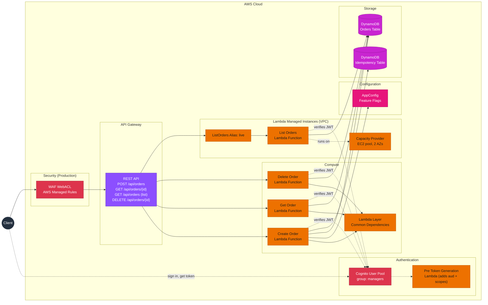
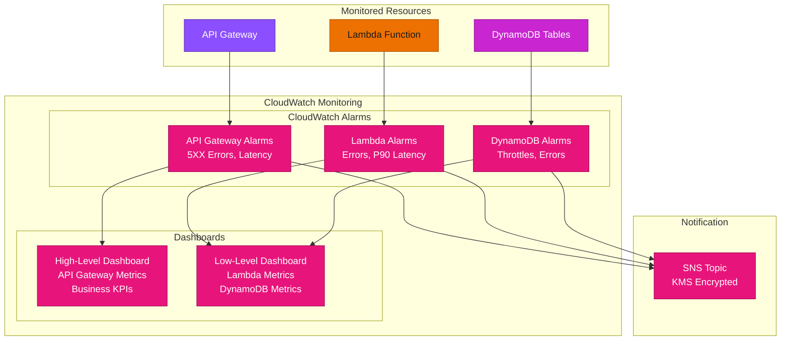

# AWS Lambda Handler Cookbook (Python)

[](https://github.com/ran-isenberg/aws-lambda-handler-cookbook/blob/master/LICENSE)

[](https://codecov.io/github/ran-isenberg/aws-lambda-handler-cookbook)


This project provides a working, open source based, AWS Lambda handler skeleton Python code includingx DEPLOYMENT code with CDK and a pipeline.

This project can serve as a blueprint for new Serverless services - CDK deployment code, pipeline and handler are covered.

**[📜Documentation](https://ran-isenberg.github.io/aws-lambda-handler-cookbook/)** | **[Blogs website](https://ranthebuilder.cloud/)**
> **Contact details | mailto:ran.isenberg@ranthebuilder.cloud**

[](https://twitter.com/RanBuilder)
[](https://ranthebuilder.cloud/)

## AWS Recommendation

This repository was recommended in an AWS blog post [Best practices for accelerating development with serverless blueprints](https://aws.amazon.com/blogs/infrastructure-and-automation/best-practices-for-accelerating-development-with-serverless-blueprints/)


## Concepts

I spoke at AWS re:invent 2023 with Heitor Lessa, former Chief Architect of Powertools for AWS Lambda about the concepts I implemented in this project.

[](https://www.youtube.com/watch?v=52W3Qyg242Y)

## Getting Started

You can start with a clean service out of this blueprint repository without using the 'Template' button on GitHub.

You can use Cookiecutter.

* Cookiecutter - install with pip/brew ``brew install cookiecutter`` or ``pip install cookiecutter``

Then run:

```bash
cookiecutter gh:ran-isenberg/cookiecutter-serverless-python
```

Answer the questions to select repo name, service name, etc.:


**That's it, your developer environment has been set! you are ready to deploy the service:**

```bash
cd {new repo folder}
uv sync
make deploy
```

Make sure you have [uv](https://docs.astral.sh/uv/) installed.

You can also run 'make pr' will run all checks, synth, file formatters , unit tests, deploy to AWS and run integration and E2E tests.

## **The Problem**

Starting a Serverless service can be overwhelming. You need to figure out many questions and challenges that have nothing to do with your business domain:

* How to deploy to the cloud? What IAC framework do you choose?
* How to write a SaaS-oriented CI/CD pipeline? What does it need to contain?
* How do you handle observability, logging, tracing, metrics?
* How do you write a Lambda function?
* How do you handle testing?
* What makes an AWS Lambda handler resilient, traceable, and easy to maintain? How do you write such a code?

## **The Solution**

This project aims to reduce cognitive load and answer these questions for you by providing a skeleton Python Serverless service blueprint that implements best practices for AWS Lambda, Serverless CI/CD, and AWS CDK in one blueprint project.

### Serverless Service - The Order service

* This project provides a working orders service where customers can create, get, list, and delete orders of items.

* The project deploys an API GW with AWS Lambda integrations and stores data in a DynamoDB table:
    * `POST /api/orders/` - Create a new order
    * `GET /api/orders/{order_id}` - Get an order by ID
    * `DELETE /api/orders/{order_id}` - Delete an order by ID
    * `GET /api/orders/?limit={n}&next_token={cursor}` - List orders with pagination, served by an **AWS Lambda Managed Instances** pool

* All `/api/orders` routes require an **Amazon Cognito access token** (`Authorization: Bearer <token>`), see [Authentication](#authentication). `/swagger` is public.



#### **Authentication**

The API is protected with **Amazon Cognito** and the Powertools for AWS Lambda [JWT verifier](https://github.com/aws-powertools/powertools-lambda-python/releases/tag/v3.36.0) (`aws_lambda_powertools.utilities.auth_alpha.JWTVerifier`, alpha). Every order Lambda verifies the access token itself (signature, issuer, expiration, app client and audience, and the scope on delete), there is no API Gateway authorizer:

| Route | Who can call it |
| --- | --- |
| `POST /api/orders`, `GET /api/orders`, `GET /api/orders/{order_id}` | Any signed in user (valid access token) |
| `DELETE /api/orders/{order_id}` | Members of the `orders-managers` group (`orders/manage` scope) |

* A missing or invalid token (an ID token too) returns `401`, a delete without the `orders/manage` scope returns `403`.
* Orders belong to the user that created them (the access token `sub` claim). Users only get, delete and list their own orders, an order of another user returns `404`, for managers too. The orders table is keyed by `owner_id` and `id`, so listing is a `Query` of the caller's orders.
* A Cognito **pre token generation** trigger (event version 2) adds the `aud` claim, and the `orders/manage` scope for members of `orders-managers`, to access tokens issued by the Cognito API, which the `JWTVerifier.cognito()` profile requires. Read about why in the [Authentication documentation](https://ran-isenberg.github.io/aws-lambda-handler-cookbook/best_practices/authentication/).
* The LIST function runs in the Lambda Managed Instances VPC without internet access, and the Cognito VPC endpoint does not serve the user pool public keys (JWKS). A deploy time custom resource fetches the JWKS and passes it to the LIST function in the `COGNITO_JWKS` environment variable, which the verifier uses instead of downloading it.
* The integration and e2e tests create real users, sign them in to get **real access tokens** and delete the users when the test session ends. The identity that runs the tests needs these permissions on the user pool: `cognito-idp:AdminCreateUser`, `AdminSetUserPassword`, `AdminAddUserToGroup`, `AdminInitiateAuth` and `AdminDeleteUser`.

#### **LIST orders via AWS Lambda Managed Instances**

The `GET /api/orders/` endpoint is deliberately powered by
[AWS Lambda Managed Instances](https://aws.amazon.com/blogs/aws/introducing-aws-lambda-managed-instances-serverless-simplicity-with-ec2-flexibility/)
(LMI) rather than standard Lambda. LMI maintains a warm pool of execution
environments on an EC2-backed capacity provider, so paginated list traffic
avoids cold starts, runs inside a private VPC with DynamoDB and observability
VPC endpoints, and can cap concurrency per environment (useful for bounding
DynamoDB Query pressure). The CRUD endpoints stay on standard Lambda — LMI is
picked per-function, only where its extra surface area pays off.

See the
[Lambda Managed Instances deep-dive](https://ran-isenberg.github.io/aws-lambda-handler-cookbook/best_practices/managed_instances/)
for tuning knobs (memory-to-vCPU ratio, min/max environments, per-env
concurrency), the matching CDK construct, and the gotchas around version
publishing and memory/CPU constraints.

#### **Monitoring Design**



### **Features**

* Python Serverless service with a recommended file structure.
* CDK infrastructure with infrastructure tests and security tests.
* CI/CD pipelines based on Github actions that deploys to AWS with python linters, complexity checks and style formatters.
* CI/CD pipeline deploys to dev/staging and production environments with different gates between each environment
* Automatic GitHub releases with semantic versioning based on conventional commits
* Automatic PR labeling based on commit message prefixes (feat, fix, docs, chore)
* Makefile for simple developer experience.
* The AWS Lambda handler embodies Serverless best practices and has all the bells and whistles for a proper production ready handler.
* AWS Lambda handler uses [AWS Lambda Powertools](https://docs.powertools.aws.dev/lambda-python/).
* AWS Lambda handler 3 layer architecture: handler layer, logic layer and data access layer
* Features flags and configuration based on AWS AppConfig
* Idempotent API
* REST API protected by WAF with four AWS managed rules in production deployment
* Amazon Cognito authentication, verified in the Lambdas by the Powertools JWT verifier: any signed in user can create, get and list orders, deleting requires the `orders/manage` scope
* Per-user order ownership: users only get, delete and list their own orders (the access token `sub` claim is the owner)
* Integration and end to end tests use real Cognito users and real access tokens, created and deleted by the tests
* CloudWatch dashboards - High level and low level including CloudWatch alarms
* Unit, infrastructure, security, integration and end to end tests.
* Automatically generated OpenAPI endpoint: /swagger with Pydantic schemas for both requests and responses
* CI swagger protection - fails the PR if your swagger JSON file (stored at docs/swagger/openapi.json) is out of date
* Automated protection against API breaking changes
* AWS Lambda Managed Instances pool powers the paginated LIST endpoint (VPC, capacity provider, warm environments)

## CDK Deployment

The CDK code creates an API GW with paths /api/orders (POST) and /api/orders/{order_id} (GET, DELETE), each backed by a dedicated Lambda function, and a Cognito user pool (with its app client, groups and pre token generation trigger) that protects them.

The AWS Lambda handler uses a Lambda layer optimization which takes all the packages under the [packages] section in the Pipfile and downloads them in via a Docker instance.

This allows you to package any custom dependencies you might have, just add them to the Pipfile under the [packages] section.

## Serverless Best Practices

The AWS Lambda handler will implement multiple best practice utilities.

Each utility is implemented when a new blog post is published about that utility.

The utilities cover multiple aspect of a production-ready service, including:

* [API Idempotency](https://ranthebuilder.cloud/blog/serverless-api-idempotency-with-aws-lambda-powertools-and-cdk/)
* [Authentication & Authorization](https://ran-isenberg.github.io/aws-lambda-handler-cookbook/best_practices/authentication/)
* [CDK Best practices](https://ranthebuilder.cloud/blog/aws-cdk-best-practices-from-the-trenches/)
* [Dynamic Configuration & feature flags](https://ranthebuilder.cloud/blog/aws-lambda-cookbook-part-6-feature-flags-configuration-best-practices/)
* [Environment Variables](https://ranthebuilder.cloud/blog/aws-lambda-cookbook-environment-variables/)
* [Input Validation](https://ranthebuilder.cloud/blog/aws-lambda-cookbook-elevate-your-handler-s-code-part-5-input-validation/)
* [Logging](https://ranthebuilder.cloud/blog/aws-lambda-cookbook-elevate-your-handler-s-code-part-1-logging/)
* [Observability: Business KPIs Metrics](https://ranthebuilder.cloud/blog/aws-lambda-cookbook-elevate-your-handler-s-code-part-3-business-domain-observability/)
* [Observability: Monitoring and Tracing](https://ranthebuilder.cloud/blog/aws-lambda-cookbook-elevate-your-handler-s-code-part-2-observability/)
* [Serverless Monitoring](https://ranthebuilder.cloud/blog/how-to-effortlessly-monitor-serverless-applications-with-cloudwatch-part-one/)
* [Serverless OpenAPI Documentation with AWS Powertools](https://ranthebuilder.cloud/blog/serverless-open-api-documentation-with-aws-powertools/)
* [Start Your AWS Serverless Service With Two Clicks](https://ranthebuilder.cloud/blog/aws-lambda-cookbook-part-7-how-to-use-the-aws-lambda-cookbook-github-template-project/)

## Getting started

Head over to the complete project documentation pages at GitHub pages at [https://ran-isenberg.github.io/aws-lambda-handler-cookbook](https://ran-isenberg.github.io/aws-lambda-handler-cookbook/)

## Code Contributions

Code contributions are welcomed. Read this [guide.](https://github.com/ran-isenberg/aws-lambda-handler-cookbook/blob/main/CONTRIBUTING.md)

## Code of Conduct

Read our code of conduct [here.](https://github.com/ran-isenberg/aws-lambda-handler-cookbook/blob/main/CODE_OF_CONDUCT.md)

## Connect

- Email: ran.isenberg@ranthebuilder.cloud
- Blog: https://ranthebuilder.cloud/
- Bluesky: [@ranthebuilder.cloud](https://bsky.app/profile/ranthebuilder.cloud)
- X:       [@RanBuilder](https://twitter.com/RanBuilder)
- LinkedIn: https://www.linkedin.com/in/ranbuilder/

## AI-Assisted Development

This project uses [AI-DLC (AI-Driven Development Life Cycle)](https://github.com/awslabs/aidlc-workflows) for AI-assisted software development. Learn more about AI-DLC in this [blog post](https://ranthebuilder.cloud/blog/ai-driven-sdlc/).

AI-DLC provides a structured, adaptive workflow for:

* **Requirements Analysis** - Intelligent requirements gathering and clarification
* **Architecture Design** - AI-assisted architectural decisions
* **Code Generation** - Structured code implementation with best practices
* **Testing** - Comprehensive test generation and validation

The AI-DLC workflow artifacts are stored in the `aidlc-docs/` directory.

### Claude Code Project Rules

The repository also ships persistent instructions for [Claude Code](https://claude.com/claude-code) and other `CLAUDE.md`-aware AI agents, so generated code follows the project's conventions automatically:

* `CLAUDE.md` - project overview, layout, and planning guidelines, loaded every session.
* `.claude/rules/` - topic-scoped rule files that load automatically; path-scoped rules load only when the matching files are edited:
    * `makefile.md` - the `make` command reference; always drive tasks through targets.
    * `github-actions.md` - CI workflows and SHA-pinning of actions.
    * `service.md` and `models.md` - handler/logic/dal layering, Powertools, and Pydantic conventions.
    * `testing.md` - unit, integration, e2e, and infrastructure test patterns.
    * `cdk.md` - construct and stack structure, and `cdk-nag` v3 suppression conventions.
    * `docs.md` - documentation build, markdownlint, and OpenAPI schema sync.
    * `security.md`, `dependencies.md`, and `git-pr.md` - secrets and IAM, dependency management, and Conventional Commits.

## Credits

* [AWS Lambda Powertools (Python)](https://github.com/aws-powertools/powertools-lambda-python)
* [AI-DLC Workflows](https://github.com/awslabs/aidlc-workflows)

## License

This library is licensed under the MIT License. See the [LICENSE](https://github.com/ran-isenberg/aws-lambda-handler-cookbook/blob/main/LICENSE) file.

Copyright (c) 2026 Ran Isenberg
